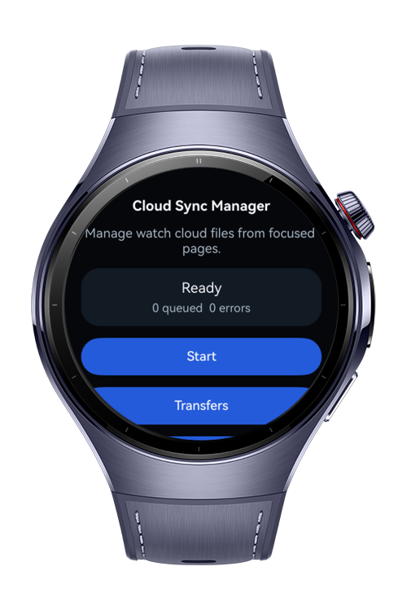
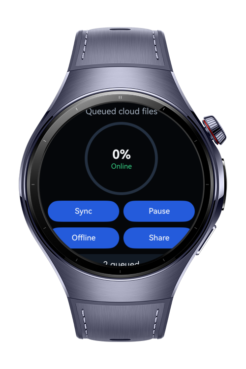
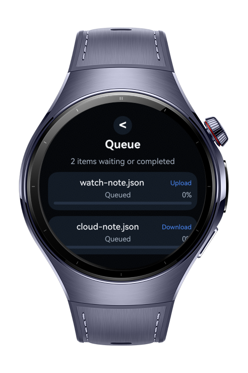
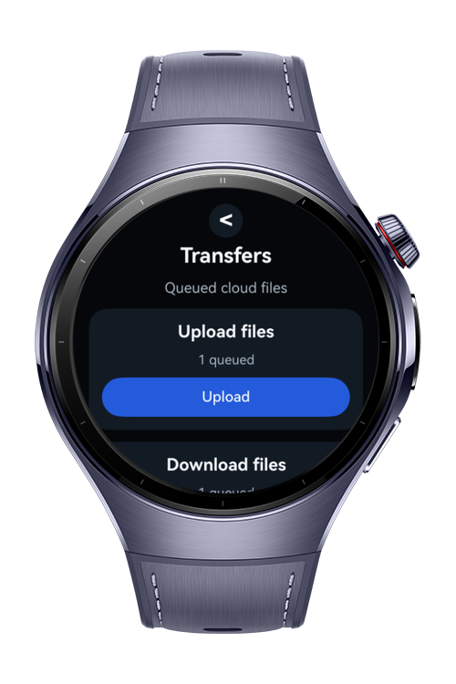

> **Note:** To access all shared projects, get information about environment setup, and view other guides, please visit [Explore-In-HMOS Index](https://github.com/Explore-In-HMOS/hmos-index).

# How To Build Cloud File Sync 

This codelab demonstrates how to build **Cloud File Sync**, a HarmonyOS wearable app for an offline-first cloud file synchronization workflow.
It shows cloud sync/cache flows, file sharing permissions, environment path handling, queued transfers, conflict handling, and compact watch navigation.

# Preview

<div>
  
  
  
  
</div>

# Use Cases

- Sync watch files with cloud storage while handling offline and online states.
- Queue uploads and downloads, then batch sync when connectivity returns.
- Share synced files from the watch to a phone with URI permission grants.
- Review transfer progress, retry failed syncs, and resolve simple file conflicts.

# Technology

## Stack

- **Languages**: ArkTS, ArkUI
- **Frameworks**: HarmonyOS SDK 6.0.1(21)
- **Tools**: DevEco Studio (HarmonyOS NEXT toolchain), Hvigor
- **Libraries**:
    - `@kit.AbilityKit`
    - `@kit.CoreFileKit`
    - `@ohos.file.cloudSync`
    - `@ohos.fileshare`
    - `@ohos.file.environment`

## Required Permissions

- `ohos.permission.FILE_ACCESS_PERSIST`
  > Required when persisted file share permissions are available on the target device.

# Directory Structure

```
entry/src/main/ets/
|---entryability
|   |---EntryAbility.ets
|---entrybackupability
|   |---EntryBackupAbility.ets
|---model
|   |---SyncModels.ets
|---pages
|   |---ErrorPage.ets
|   |---Index.ets
|   |---QueuePage.ets
|   |---StartPage.ets
|   |---TransferPage.ets
|---service
|   |---CloudSyncService.ets
|   |---ConflictResolver.ets
|   |---EnvironmentPathService.ets
|   |---FileShareService.ets
|   |---OfflineQueueService.ets
|   |---SyncCoordinator.ets
|   |---SyncCoordinatorStore.ets
|---util
|   |---Constants.ets
```

# Constraints and Restrictions

## Supported Device

- Huawei Watch 5

## Additional Notes

- The app name and project name are `how-to-build-cloud-file-sync-on-watch`.
- Navigation uses `Navigation` and `NavPathStack` instead of the deprecated Router API.
- Placeholder media resources are intentionally minimal.

# License

**how-to-build-cloud-file-sync-on-watch** is distributed under the terms of the MIT License.
See the [LICENSE](./LICENSE) for more information.
